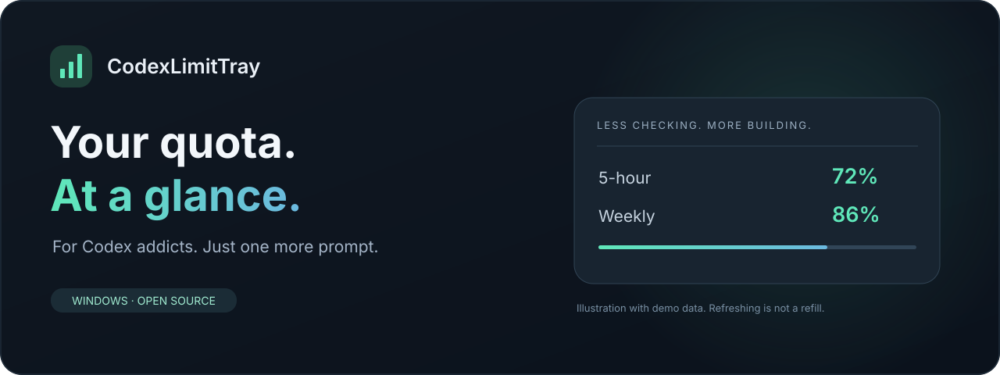
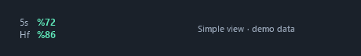
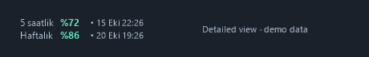
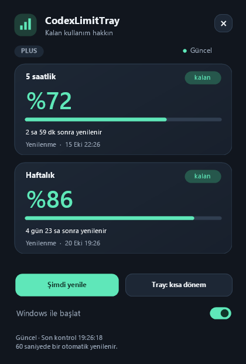

<div align="center">



# CodexLimitTray · CLT

### For Codex addicts. Just one more prompt.

Your remaining Codex limits, quietly living in the Windows taskbar.


[Download portable EXE](https://github.com/ugurozdagli/CodexLimitTray/releases/latest) · [Screenshots](#screenshots) · [How it works](#how-it-works) · [Privacy](PRIVACY.md) · [Türkçe](docs/README.tr.md)

<sub>*Refreshing the counter does not refill your quota. Unfortunately.</sub>

</div>

---

## A tiny counter for a very familiar habit

If you have ever interrupted your flow to check whether you can squeeze in **one more Codex prompt**, CLT is for you. It puts your short-term and weekly **remaining** percentages beside the system tray, with a clean detail panel a click away.

No extra API key. No CLT account. No dashboard to keep open. Use the Codex account already signed in on **your own computer**.

## Screenshots

These previews are rendered by the application using **fictional demo data**. They do not show the maintainer's account. The interface currently speaks **Turkish**; this README is in English.

### At a glance

| Simple | Detailed |
| --- | --- |
| Compact labels and remaining percentages. | Limit names, remaining percentages, and local reset dates. |
|  |  |

### One click deeper

<p align="center">
  
</p>

## What you get

| Feature | What it does |
| --- | --- |
| Two-line taskbar widget | Shows short-term and weekly remaining usage together. |
| Simple / Detailed views | Keep it compact, or add the reset date and time to each row. |
| Color at a glance | Green above 35%, amber at 16–35%, red at 0–15% remaining. |
| Detail panel | Rounded dark cards, smooth text, remaining bars, reset countdowns, and last refresh. |
| Automatic refresh | Checks every 60 seconds; manual refresh is one click away. |
| Honest connection state | Shows a dash when data is unavailable; old data is labeled in the panel. |
| Move & lock | Drag horizontally, lock the position, or reset it from the context menu. |
| Optional startup | Start with Windows if you choose. Off by default. |
| Tray fallback | A small percentage icon provides another way to open the panel and settings. |
| Turkish support | Native Turkish labels and local reset times. |

## Download & run

1. Open the [latest release](https://github.com/ugurozdagli/CodexLimitTray/releases/latest).
2. Download **`CodexLimitTray-v1.2.0-win-x64.exe`** for a single portable executable, or choose the ZIP with documentation.
3. Save the EXE in a permanent folder and run it. For the ZIP, extract first and run **`CodexLimitTray.exe`**.
4. Make sure Codex is installed and signed in with your own ChatGPT account.

Both downloads are **self-contained** Windows x64 builds with the .NET runtime included. There is no installer wizard or .NET prerequisite. Preferences still live in your current user's local app-data folder; see [Privacy](PRIVACY.md). Codex itself is a separate prerequisite and is **not bundled**.

**Target:** Windows 11 x64 with the primary monitor's horizontal taskbar. Windows 10, vertical taskbars, and native ARM64 builds are not part of the currently verified setup.

Releases include **SHA-256 checksums** and **GitHub build-provenance attestations** so you can check file integrity and which repository/workflow built the download. See [Verify your download](docs/VERIFYING-DOWNLOADS.md). These are not Windows publisher signatures or a guarantee of safety: the initial build is **not code-signed**, and an unknown-publisher warning is possible. Do not disable Windows security features to run it. Building from source is also supported.

### The short Turkish-to-English guide

| You see | It means |
| --- | --- |
| `5s` / `5 saatlik` | Five-hour window, when the account returns that duration. |
| `Hf` / `Haftalık` | Weekly window. |
| `Görünüm → Basit / Detaylı` | Appearance → Simple / Detailed. |
| `Şimdi yenile` | Refresh now. |
| `Windows ile başlat` | Start with Windows. |
| `Gösterge konumunu kilitle` | Lock the widget position. |
| `Gösterge konumunu sıfırla` | Reset the widget position. |
| `Çıkış` | Exit. |

**Left-click** the widget to open the panel. **Right-click** for settings. **Drag** horizontally to reposition it. Escape or a click outside closes the panel. Launching CLT again opens the existing instance.

## How it works

```text
CLT  ── stdio JSON-RPC ──>  your local Codex app-server  ──>  Codex services
        initialize
        initialized
        account/rateLimits/read
```

CLT locates `codex.exe` from the desktop application's local installation, then checks `PATH`. It starts a short-lived `codex app-server` process, reads the account's rate limits, and closes the helper. It never starts a model turn or asks Codex to run tools.

The Codex process handles authentication using the current user's existing session. CLT does not directly read `auth.json` or ask for an API key. It does not open a network listener. The Codex helper still communicates with OpenAI under its own settings. See [OpenAI's App Server documentation](https://learn.chatgpt.com/docs/app-server#6-rate-limits-chatgpt).

An explicit `CLT_CODEX_PATH` environment variable can point to a trusted `codex.exe` if automatic discovery fails. Only use a binary you trust.

## Privacy & security

- **Your account stays yours.** An installed copy reads the Codex session on that computer; the maintainer's account is not included in the release.
- **No CLT telemetry or usage-history database.** The application stores display preferences locally and keeps the current usage snapshot in memory.
- **No administrator prompt.** Optional startup uses the current user's Windows startup registry entry.
- **No credential bundle.** Source and release packages exclude local shortcuts, account files, settings, scratch files, and private keys. Release debug symbols are disabled.
- **Read-only protocol use.** Unexpected app-server requests are rejected; CLT does not approve tool execution.

These are design choices, **not a guarantee of zero vulnerabilities**. CLT runs with normal user permissions and depends on a trustworthy Codex installation. Read [PRIVACY.md](PRIVACY.md) and [SECURITY.md](SECURITY.md) for the boundaries and reporting process.

## Build from source

Install the **.NET 10 SDK** on Windows, then run these commands from the repository root:

```powershell
# Small build; requires the .NET 10 Windows Desktop Runtime on the target PC.
.\build.ps1

# Standalone build; includes the runtime.
.\build.ps1 -SelfContained

# Clean distribution ZIP + SHA-256 manifest.
.\package.ps1
```

There are no third-party NuGet package references. The SDK still restores Microsoft's framework/runtime packages. Local output goes into `release/` and `dist/`, which are excluded from Git.

### Checks and documentation previews

```powershell
$check = Start-Process .\release\CodexLimitTray.exe `
  -ArgumentList '--self-test', 'checks.json' -Wait -PassThru
if ($check.ExitCode -ne 0) { throw 'Checks failed' }

# Offline previews with fictional data; no Codex login required.
Start-Process .\release\CodexLimitTray.exe `
  -ArgumentList '--demo-previews', 'docs\images' -Wait
```

Additional `--smoke-test`, `--smoke-test-error`, `--diagnose`, and live `--preview` modes exist for local troubleshooting. Live diagnostics can contain usage/reset information: keep those outputs out of issues and commits. Never attach raw authentication files.

## Limits worth knowing

- The widget is a transparent window over the taskbar. Windows does not reserve space for it; drag it into a free area if taskbar buttons overlap.
- Full-screen applications hide the widget. Normal maximized windows and the task switcher are treated separately.
- Codex can return different windows or no subscription limit data. API-key billing is not the same as ChatGPT subscription allowances.
- Missing data is shown as unavailable, rather than guessed. Data older than three minutes is treated as stale.
- Moving the executable after enabling startup requires toggling startup off and on to update its path.
- The app-server interface and desktop installation layout can change. See [Troubleshooting](docs/TROUBLESHOOTING.md).

## Contributing

Bug reports, small fixes, accessibility improvements, and localization work are welcome. Start with [CONTRIBUTING.md](CONTRIBUTING.md). English UI localization is a useful future contribution; **English UI is not implemented yet**.

Please use private reporting for security issues, and remove personal information from screenshots and logs. See [SECURITY.md](SECURITY.md).

## License & credits

[MIT](LICENSE). Built with C#, WinForms, and .NET. Bundled runtime licenses and attributions are in [THIRD-PARTY-NOTICES.txt](THIRD-PARTY-NOTICES.txt) and embedded in the standalone executable. The taskbar idea is inspired by utilities such as NetSpeedTray; CLT's implementation and icon are its own.

CodexLimitTray is an independent community project. It is **not affiliated with, endorsed by, or maintained by OpenAI**. Codex and OpenAI names belong to their respective owners.
